<div align="center">


# Cemita Burger & BBQ — site e sistema de pedidos

**Site institucional, cardápio digital e sistema próprio de pedidos online, com painel para a equipe da cozinha e do balcão.**
Feito sob medida para uma hamburgueria de Joinville/SC, do visual à regra de negócio.


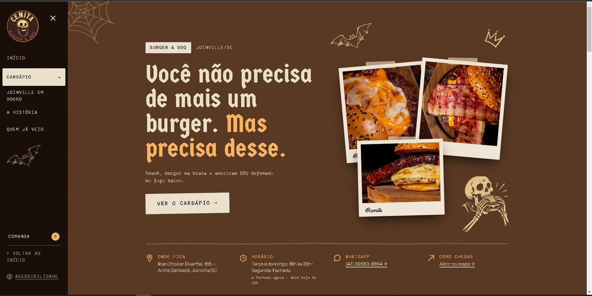

</div>

---

## Sumário

- [Sobre o projeto](#sobre-o-projeto)
- [O site na prática](#o-site-na-prática)
- [Funcionalidades](#funcionalidades)
- [Tecnologias](#tecnologias)
- [Arquitetura em uma imagem](#arquitetura-em-uma-imagem)
- [Rodando na sua máquina](#rodando-na-sua-máquina)
- [Documentação](#documentação)
- [Status do projeto](#status-do-projeto)
- [Autor](#autor)

## Sobre o projeto

O Cemita é uma hamburgueria de burger na brasa e american BBQ com identidade gótica e bem-humorada ("aqui jaz a sua fome"). Até aqui, quem digitava o endereço da casa era levado direto para uma plataforma de delivery de terceiros: cardápio, fotos, pedidos e dados dos clientes ficavam fora da marca.

Este projeto entrega:

- **um site com a cara da casa**, com cardápio no estilo de menu impresso, fotos reais e acessibilidade;
- **um sistema de pedidos próprio** (retirada ou entrega, pagamento na entrega, Pix e cartão via Mercado Pago);
- **um painel para a equipe**, com quadro de pedidos para a cozinha, controle do cardápio, da loja, das zonas de entrega e da agenda de eventos.

Tudo foi pensado para **rodar sozinho depois de publicado**: a equipe do restaurante cuida do dia a dia pelo painel, e as atualizações de código são testadas e publicadas automaticamente.

## O site na prática

> As telas abaixo são do sistema rodando de verdade, num teste de ponta a ponta. Os dados de cliente e as zonas marcadas com `[DEV]` são fictícios, e o endereço de entrega foi borrado.

### 1. Cardápio e comanda

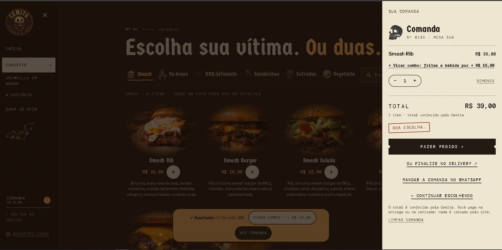

Cardápio com foto, preço e descrição. A comanda soma os itens e mostra o total **conferido pelo servidor**; depois de anotar um lanche, o site oferece **"Virar combo"**.

### 2. Fazendo o pedido

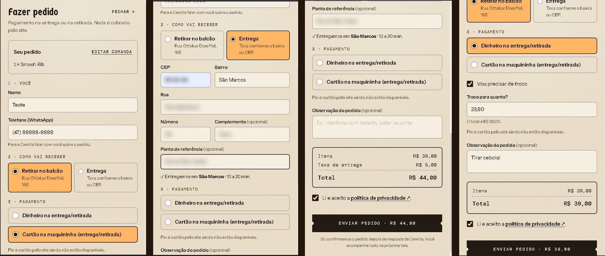

Retirada no balcão ou entrega. Pelo CEP ou bairro, o sistema encontra a zona de entrega e soma a taxa. Pagamento em dinheiro (com troco) ou maquininha na entrega, e Pix ou cartão pelo site quando o Mercado Pago estiver ligado.

### 3. Acompanhamento pelo cliente

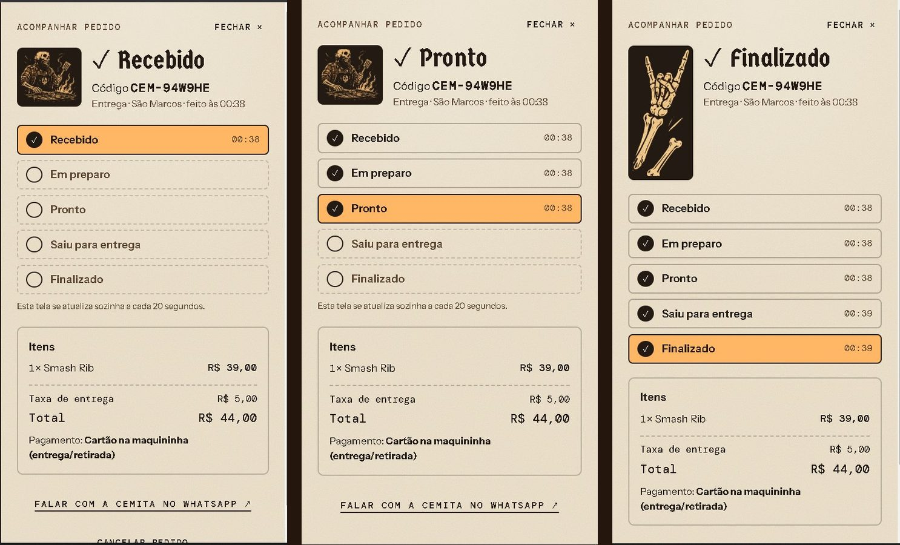

A tela do pedido se atualiza sozinha a cada passo da cozinha. Enquanto o pedido está "Recebido", o próprio cliente pode cancelar.

### 4. Painel da cozinha

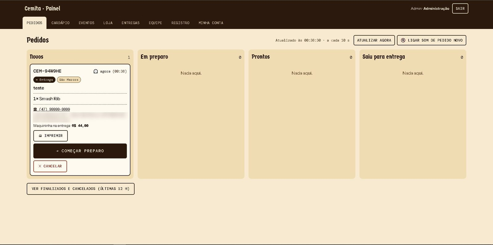

Quadro em colunas (Novos → Em preparo → Prontos → Saiu para entrega), atualizado a cada 10 segundos, com alerta sonoro de pedido novo e impressão do cupom em impressora térmica.

<table>
<tr>
<td width="50%">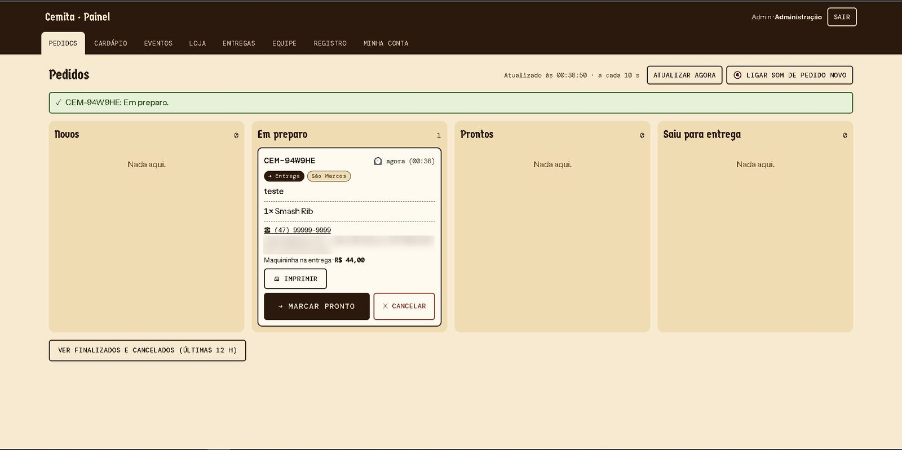</td>
<td width="50%">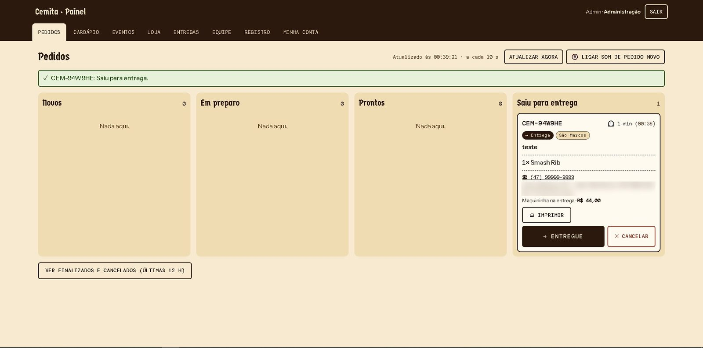</td>
</tr>
<tr>
<td align="center"><sub>Em preparo</sub></td>
<td align="center"><sub>Saiu para entrega</sub></td>
</tr>
</table>

### 5. Gestão da loja

<table>
<tr>
<td width="50%">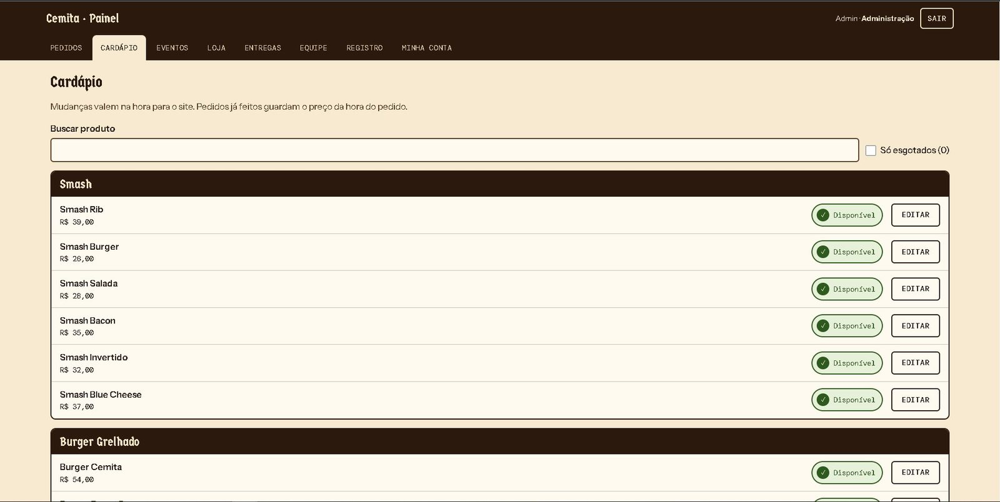</td>
<td width="50%">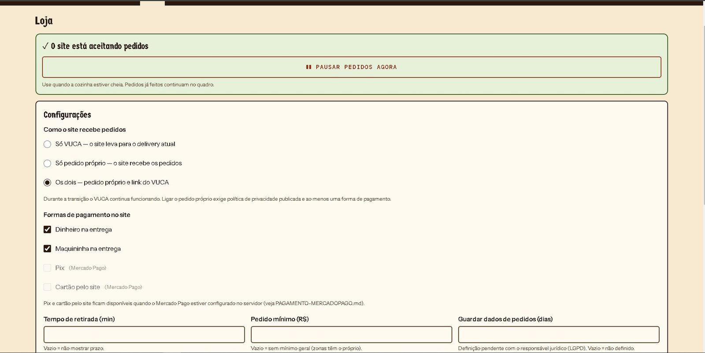</td>
</tr>
<tr>
<td align="center"><sub>Cardápio: disponível/esgotado, preço e texto</sub></td>
<td align="center"><sub>Loja: modo de pedido e formas de pagamento</sub></td>
</tr>
<tr>
<td width="50%">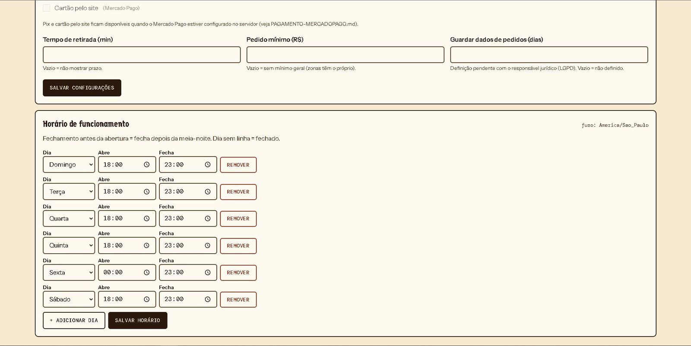</td>
<td width="50%">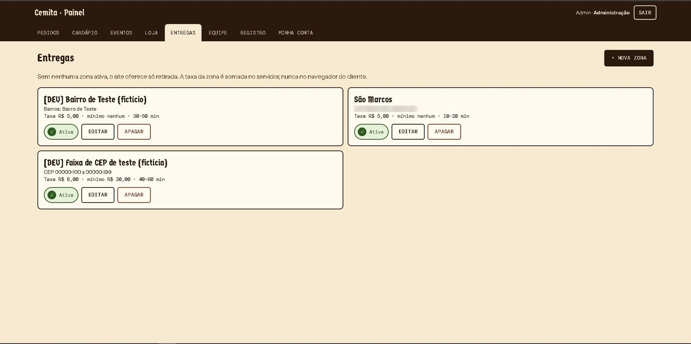</td>
</tr>
<tr>
<td align="center"><sub>Horário: a loja abre e fecha sozinha</sub></td>
<td align="center"><sub>Zonas de entrega por bairro ou faixa de CEP</sub></td>
</tr>
<tr>
<td width="50%">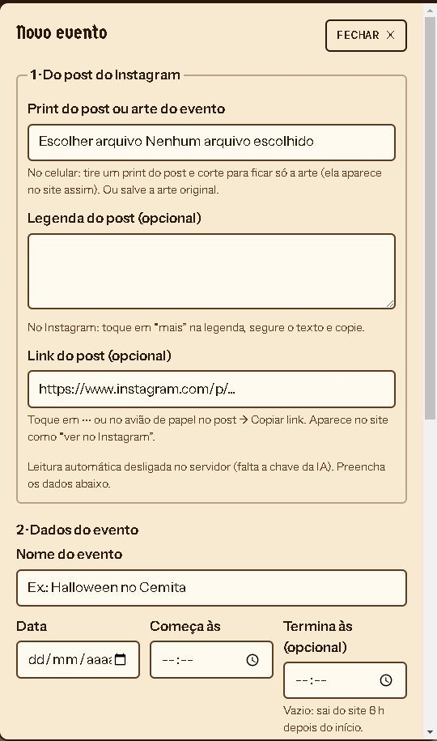</td>
<td width="50%">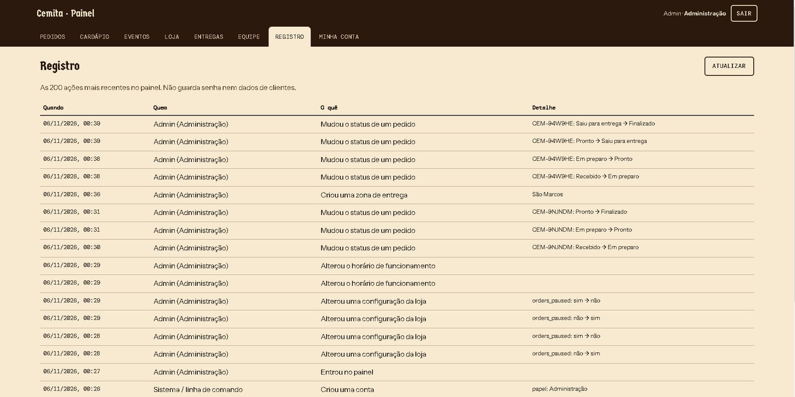</td>
</tr>
<tr>
<td align="center"><sub>Eventos a partir do post do Instagram (com IA opcional)</sub></td>
<td align="center"><sub>Registro de quem fez o quê</sub></td>
</tr>
</table>

## Funcionalidades

**Para o cliente**
- Cardápio digital com busca, categorias, fotos reais e preços vindos de uma configuração central.
- Comanda com ponto da carne, adicionais, combo com bebida e "virar combo".
- Pedido para retirada ou entrega, com taxa automática por zona (bairro ou faixa de CEP).
- Pagamento na entrega (dinheiro com troco, maquininha) e online (Pix e cartão via Mercado Pago Checkout Pro).
- Acompanhamento do pedido com atualização automática e cancelamento enquanto ainda não foi para a chapa.
- Agenda de eventos (shows, stand-up, noites temáticas) com reserva pelo WhatsApp.
- Aviso automático de loja fechada pelo horário de funcionamento.
- Painel de acessibilidade, contraste conferido, navegação por teclado e leitor de tela.
- Prévia do link no WhatsApp/redes e dados estruturados para o Google (cardápio, horário, endereço, eventos).

**Para a equipe (painel `/admin/`)**
- Login individual com três papéis: **administração**, **atendimento** e **cozinha**.
- Quadro de pedidos com alerta sonoro, impressão do cupom e cancelamento com motivo.
- Produto disponível/esgotado em um toque; preço e texto editáveis pela administração.
- Pausar pedidos, horário de funcionamento, modo de pedido (delivery externo, pedido próprio ou os dois).
- Zonas de entrega com taxa, prazo e pedido mínimo.
- Eventos: envia o print do post do Instagram e a IA preenche nome, data e atrações para a equipe conferir.
- Gestão da equipe e registro de auditoria das ações.

## Tecnologias

| Camada | Tecnologias |
|---|---|
| Site e painel | React 19, TypeScript, Vite, Tailwind CSS v4, GSAP |
| API | Node.js 22, Express 5, Sequelize, Zod, Pino |
| Banco de dados | MySQL 8.4 |
| Pagamentos | Mercado Pago Checkout Pro (webhook com assinatura verificada) |
| IA (opcional) | API da Anthropic para ler o post do evento |
| Testes | `node:test` (site e API) e testes de integração da API com MySQL, rodando no GitHub Actions |
| Publicação | Docker, Railway, GitHub Actions |

## Arquitetura em uma imagem

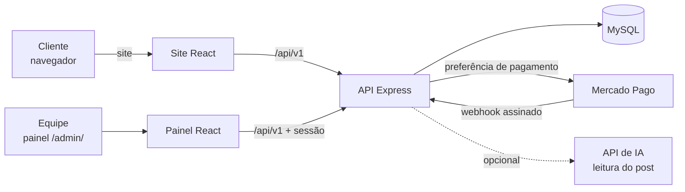

Em produção, um único serviço entrega o site, o painel e a API no mesmo endereço. Detalhes em [docs/TECNICO.md](docs/TECNICO.md).

## Rodando na sua máquina

Pré-requisitos: **Node.js 22.12+** e **MySQL 8.4** (Docker ou instalado no Windows).

```bash
# API (janela 1)
cd server
cp .env.example .env
npm install
npm run db:migrate
npm run db:seed        # cardápio, adicionais e combos
npm run db:seed:dev    # dados FICTÍCIOS de teste (zona de entrega, política DEV)
npm run admin:create   # cria a sua conta do painel
npm run dev            # http://localhost:3333

# Site e painel (janela 2)
cd ..
cp .env.example .env.local
npm install
npm run dev            # site: http://localhost:5173 · painel: http://localhost:5173/admin/
```

Roteiro completo de teste, inclusive pelo celular: [TESTE-HOJE.md](TESTE-HOJE.md).

## Documentação

| Documento | Conteúdo |
|---|---|
| [docs/TECNICO.md](docs/TECNICO.md) | Arquitetura, regras de negócio, segurança, testes e decisões técnicas |
| [TESTE-HOJE.md](TESTE-HOJE.md) | Como rodar e testar o sistema de ponta a ponta |
| [PUBLICAR.md](PUBLICAR.md) | Publicação no Railway com banco, domínio, backups e monitoramento |
| [PAGAMENTO-MERCADOPAGO.md](PAGAMENTO-MERCADOPAGO.md) | Como ligar Pix e cartão pelo Mercado Pago |
| [EVENTOS.md](EVENTOS.md) | Agenda de eventos e leitura do post com IA |

## Status do projeto

- [x] Site, cardápio e comanda
- [x] Pedido próprio (retirada e entrega) e acompanhamento
- [x] Painel da equipe com papéis, auditoria e alerta de pedido novo
- [x] Pagamento online (Mercado Pago), pronto para ligar com as credenciais do restaurante
- [x] Agenda de eventos com IA opcional
- [x] Publicação automatizada (Docker + GitHub Actions)
- [ ] Publicação no domínio do restaurante

## Autor

**Erik Pinheiro** — estudante de Engenharia de Software (Católica SC, Joinville).

[GitHub](https://github.com/PPereiraErik) · [LinkedIn](https://www.linkedin.com/in/erik-pinheiro-715589374) · [Portfólio](https://portfolio-one-gold-74.vercel.app)

<sub>Nome, logotipo, fotos e cardápio pertencem ao Cemita Burger & BBQ e aparecem aqui com fins de apresentação do projeto.</sub>
