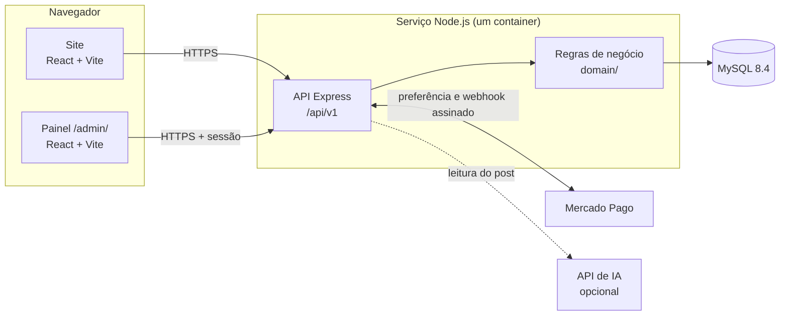
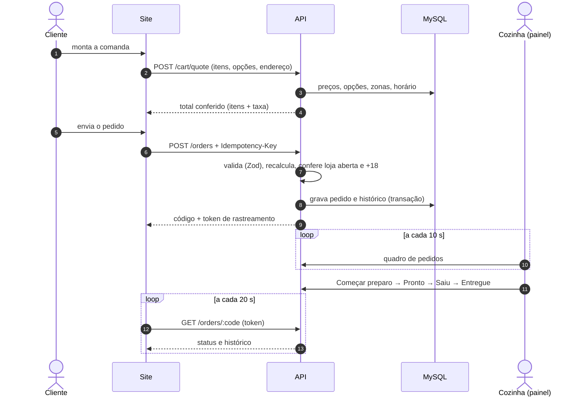
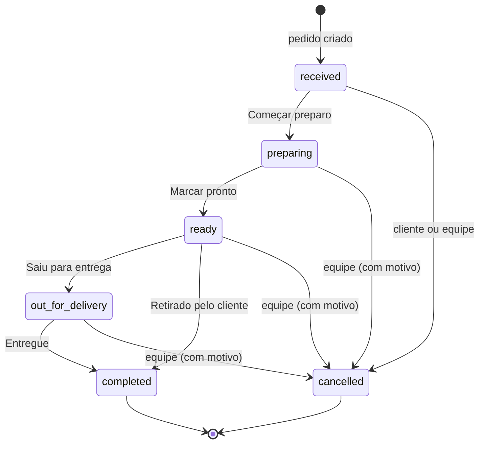
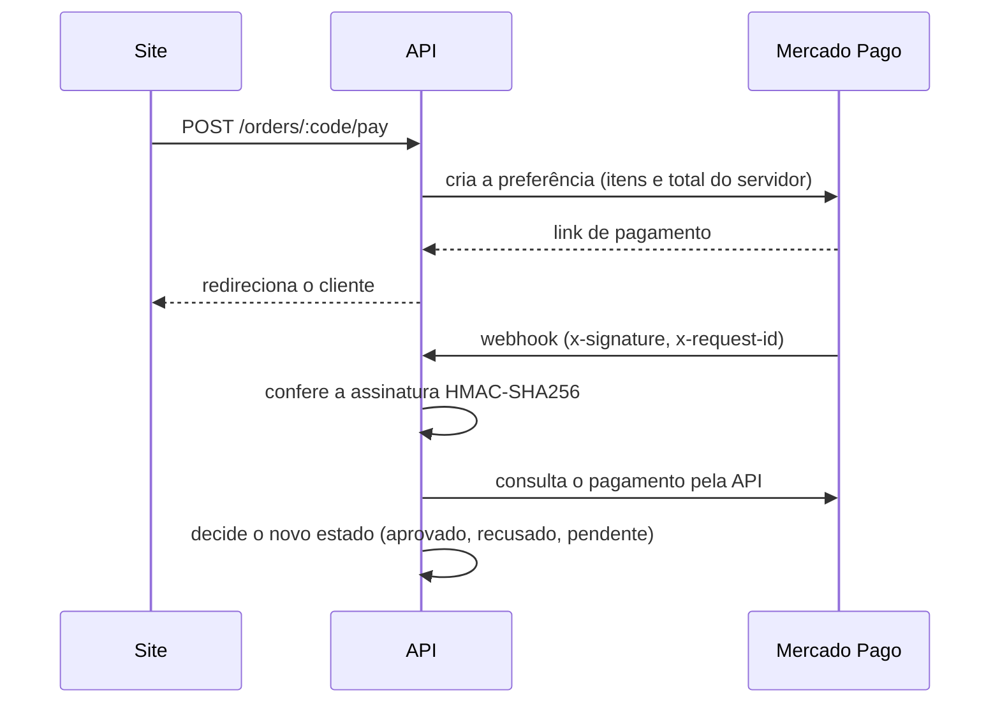

# Documentação técnica

Como o site e o sistema de pedidos do Cemita foram construídos: arquitetura, regras de negócio, segurança, testes e publicação.

> Visão geral e telas do sistema: [README](../README.md).

## Sumário

1. [Objetivos e princípios](#1-objetivos-e-princípios)
2. [Arquitetura](#2-arquitetura)
3. [Estrutura do repositório](#3-estrutura-do-repositório)
4. [Site (frontend)](#4-site-frontend)
5. [API (backend)](#5-api-backend)
6. [Fluxo de um pedido](#6-fluxo-de-um-pedido)
7. [Preço calculado no servidor](#7-preço-calculado-no-servidor)
8. [Status do pedido](#8-status-do-pedido)
9. [Pagamento online (Mercado Pago)](#9-pagamento-online-mercado-pago)
10. [Painel da equipe: acesso e permissões](#10-painel-da-equipe-acesso-e-permissões)
11. [Agenda de eventos e IA](#11-agenda-de-eventos-e-ia)
12. [Privacidade e LGPD](#12-privacidade-e-lgpd)
13. [Segurança](#13-segurança)
14. [SEO e compartilhamento](#14-seo-e-compartilhamento)
15. [Testes](#15-testes)
16. [Publicação e operação](#16-publicação-e-operação)
17. [Variáveis de ambiente](#17-variáveis-de-ambiente)
18. [Decisões técnicas](#18-decisões-técnicas)
19. [Limitações conhecidas](#19-limitações-conhecidas)

---

## 1. Objetivos e princípios

O projeto substitui um redirecionamento para uma plataforma de delivery de terceiros por um site e um sistema de pedidos próprios do restaurante. As decisões seguem alguns princípios fixos:

| Princípio | Na prática |
|---|---|
| **Nenhum dado de negócio inventado** | Preços, produtos, horários e links vêm de uma configuração central. O que o restaurante ainda não definiu fica como pendência visível, nunca como valor chutado. |
| **O navegador nunca define preço** | O site mostra valores, mas o total de qualquer pedido é recalculado pela API com os dados do banco. |
| **Nenhum dado de cartão passa pelo sistema** | O pagamento online acontece na página do Mercado Pago; o pedido só vira "pago" com a confirmação assinada do próprio Mercado Pago. |
| **Sem credenciais padrão** | Toda conta do painel é criada explicitamente; segredos ficam em variáveis de ambiente. |
| **Sem dados pessoais nos logs** | Logs estruturados, sem telefone, endereço ou senha. |
| **Roda sem o desenvolvedor** | A equipe opera tudo pelo painel; publicação, migrações e testes são automáticos. |
| **Acessível** | Contraste conferido, alvos de toque grandes, navegação por teclado, leitor de tela e painel de acessibilidade. |

## 2. Arquitetura



- **Desenvolvimento:** o Vite serve o site e o painel (porta 5173) e a API roda separada (porta 3333).
- **Produção:** um único container entrega o site compilado, o painel e a API **na mesma origem**. Assim o cookie de sessão do painel (`SameSite=Strict`) funciona sem configuração de CORS.
- A API é organizada em camadas: **rotas** (HTTP) → **serviços** (orquestração, transações) → **domínio** (regras puras, sem banco) → **modelos** (Sequelize).

## 3. Estrutura do repositório

```
.
├── index.html                 # página do site (Vite)
├── admin/index.html           # página do painel (Vite, multi-página)
├── src/
│   ├── config/                # FONTE ÚNICA: restaurante, cardápio, adicionais, SEO
│   ├── lib/                   # estado (comanda, interface), cliente da API, regras puras
│   ├── site/                  # seções do site (início, cardápio, agenda, história…)
│   ├── world/                 # comanda e janela do produto
│   ├── admin/                 # telas do painel, alertas, impressão
│   └── assets/                # fotos, ilustrações e fontes
├── tests/                     # testes do site (node:test)
├── seo.plugin.ts              # plugin do Vite: JSON-LD, imagem de compartilhamento, sitemap
├── scripts/                   # exporta o cardápio do site para o seed da API
├── server/
│   ├── src/
│   │   ├── config/            # leitura e validação do ambiente, conexão com o banco
│   │   ├── db/                # migrations, seeders e catálogo inicial
│   │   ├── models/            # modelos Sequelize
│   │   ├── domain/            # regras puras: preço, status, pagamento, eventos, permissões
│   │   ├── services/          # pedidos, loja, autenticação, auditoria, pagamentos, eventos
│   │   ├── routes/            # rotas públicas e do painel
│   │   ├── validators/        # esquemas Zod das entradas
│   │   ├── payments/          # integração Mercado Pago
│   │   ├── ai/                # leitura de post de evento com IA
│   │   └── site/              # entrega do site em produção
│   ├── scripts/               # banco, criação de conta, preparação da publicação
│   └── tests/                 # unidade e integração (MySQL)
├── Dockerfile                 # imagem de produção (site + painel + API)
└── .github/workflows/ci.yml   # testes a cada envio
```

## 4. Site (frontend)

**Stack:** React 19, TypeScript, Vite, Tailwind CSS v4 e GSAP para as animações.

### Configuração central
`src/config/` concentra tudo o que é do restaurante: nome, endereço, horário, contatos, redes, cardápio (categorias, produtos, preços, "a partir de"), adicionais e combos. Nenhum componente tem preço ou texto de negócio fixo. O mesmo cardápio é exportado (`scripts/export-menu.mjs`) para o seed da API, para que site e banco partam dos mesmos dados.

O cardápio tem modelos de exibição por categoria: **menu impresso** (lanches, com foto) e **lista** (cervejas e bebidas).

### Comanda
- Estado em um store próprio, persistido no `sessionStorage` (sobrevive a recarregar a página, some ao fechar a aba).
- Cada linha guarda produto, quantidade, opções (ponto da carne, adicionais, combo e bebida) e observação.
- **"Virar combo"**: depois de anotar um lanche elegível sem combo, um aviso oferece a troca, e a comanda mostra o mesmo atalho na linha. A troca **substitui** a linha (não duplica).
- Com o pedido próprio ligado, o site busca o catálogo da API e cruza as opções da comanda com os IDs do servidor (por grupo e nome normalizado). O total exibido vem da **cotação do servidor** (`POST /cart/quote`).
- Alternativas sempre disponíveis: mandar a comanda pelo WhatsApp ou finalizar no delivery externo.

### Estados da loja no site
O site consulta `GET /store/status` e reage: aberto, fechado pelo horário, pausado, sem pedido próprio. O motivo aparece para o cliente e o botão de pedir fica desabilitado, com explicação.

### Acessibilidade
- Contraste mínimo de 4,5:1 nos textos; alvos de toque com 44 px ou mais.
- Foco visível, navegação por teclado e rótulos para leitor de tela.
- Painel de acessibilidade e respeito a `prefers-reduced-motion`.

## 5. API (backend)

**Stack:** Node.js 22, Express 5, Sequelize (MySQL 8.4), Zod para validação e Pino para logs.

### Rotas públicas (`/api/v1`)

| Método e rota | Função |
|---|---|
| `GET /health` | Saúde da API e do banco (usado pela hospedagem e pelo monitor) |
| `GET /catalog` | Categorias, produtos, grupos de opções e disponibilidade |
| `GET /store/status` | Se a loja aceita pedidos agora, motivos, formas de pagamento, política vigente |
| `POST /cart/quote` | Cotação: recalcula itens, opções, taxa de entrega e total |
| `POST /orders` | Cria o pedido (exige `Idempotency-Key` para não duplicar em reenvio) |
| `GET /orders/:code` | Acompanhamento (exige o token de rastreamento do pedido) |
| `POST /orders/:code/cancel` | Cancelamento pelo cliente, se o status permitir |
| `POST /orders/:code/pay` | Inicia o pagamento online e devolve o link do Mercado Pago |
| `POST /payments/mercadopago/webhook` | Aviso de pagamento, com assinatura verificada |
| `GET /events` · `GET /events/:id/image` | Agenda pública e arte de cada evento |

### Rotas do painel (`/api/v1/admin`)
Login e sessão, pedidos (quadro e mudança de status), produtos, loja (pausa, horário, configurações), zonas de entrega, equipe, registro de auditoria e eventos (incluindo a leitura por IA). Cada rota declara a **permissão** exigida (seção 10).

### Banco de dados
- Esquema versionado em **migrations**, aplicadas por `npm run db:migrate` (e automaticamente na publicação).
- **Seeders** idempotentes: carregam o cardápio inicial, os grupos de opções (ponto da carne, adicionais, combo com bebida), o horário e as configurações; rodar de novo só acrescenta o que falta.
- O pedido guarda uma **cópia** de nome, preço e opções de cada item no momento da compra; mudar o cardápio depois não altera pedidos antigos.

## 6. Fluxo de um pedido



## 7. Preço calculado no servidor

A regra de preço é uma função pura do domínio, usada tanto na cotação quanto na criação do pedido:

1. Cada item precisa existir, estar ativo, disponível e ser **pedível pelo site** (itens "a partir de", cujo preço depende de tamanho ainda não cadastrado, ficam fora).
2. As opções são validadas contra os grupos do produto: mínimo e máximo de escolhas por grupo (o ponto da carne é obrigatório nos burgers na brasa), itens ativos e disponíveis.
3. Preço da linha = (preço do produto + soma das opções) × quantidade.
4. Entrega: o endereço é comparado com as zonas ativas (lista de bairros ou faixa de CEP). Sem zona, não há entrega; com zona, soma a taxa e confere o pedido mínimo dela.
5. Pedido mínimo geral da loja, quando configurado.
6. Itens alcoólicos exigem a confirmação de maioridade.

O valor que o navegador envia é ignorado. Qualquer divergência vira um erro com a lista do que precisa de atenção.

## 8. Status do pedido



- As transições permitidas ficam no domínio; a API recusa saltos inválidos.
- A **cozinha** só avança de recebido para em preparo e de em preparo para pronto. Cancelamento é do atendimento ou da administração e exige motivo.
- O **cliente** só cancela enquanto o pedido está "Recebido".
- Cada mudança entra no histórico do pedido (mostrado ao cliente com horário) e no registro de auditoria.
- O acompanhamento não exige login: o cliente recebe um **token de rastreamento** assinado com um segredo do servidor (`TRACKING_TOKEN_SECRET`) e guardado no próprio aparelho.

## 9. Pagamento online (Mercado Pago)

Integração com o **Checkout Pro**: o cliente paga na página do Mercado Pago (Pix ou cartão) e volta para o acompanhamento.



- A assinatura do webhook é verificada sobre o manifesto `id:<data.id>;request-id:<x-request-id>;ts:<ts>;` com o segredo do webhook.
- Depois de verificado, o estado é confirmado consultando o pagamento direto na API do Mercado Pago. O retorno do navegador **nunca** marca um pedido como pago.
- O sistema não recebe, não processa e não guarda dados de cartão.
- Sem as credenciais configuradas, Pix e cartão simplesmente não aparecem como opção, e o pedido segue com pagamento na entrega.

## 10. Painel da equipe: acesso e permissões

### Autenticação
- Senhas com **scrypt** (custo configurável) e política de senha longa (12+ caracteres, recusa senhas fáceis ou ligadas ao nome e ao e-mail).
- Sessão em cookie `HttpOnly` e `SameSite=Strict`, com proteção CSRF por cabeçalho nas ações.
- **Bloqueio temporário da conta** após 5 senhas erradas.
- Trocar a senha encerra as sessões nos outros aparelhos.
- Não há conta padrão: a primeira é criada pela linha de comando (`npm run admin:create`) ou, na primeira publicação, por variáveis de ambiente que devem ser apagadas depois.

### Papéis e permissões

| Permissão | Administração | Atendimento | Cozinha |
|---|:---:|:---:|:---:|
| Ver a fila de pedidos | ✓ | ✓ | ✓ |
| Ver telefone e endereço do cliente | ✓ | ✓ | — |
| Marcar produto disponível/esgotado | ✓ | ✓ | — |
| Editar nome, descrição e preço | ✓ | — | — |
| Pausar e retomar pedidos | ✓ | ✓ | — |
| Configurações e horário da loja | ✓ | — | — |
| Zonas de entrega | ✓ | — | — |
| Equipe (contas e senhas) | ✓ | — | — |
| Registro de auditoria | ✓ | — | — |
| Eventos da agenda | ✓ | ✓ | — |

As permissões são checadas **na API** (o painel apenas esconde o que a pessoa não pode usar).

### Alerta de pedido novo e impressão
- O quadro consulta a API a cada 10 s, mesmo com a aba em segundo plano. Com o som ligado (preferência salva no aparelho), um pedido novo toca três bipes (Web Audio), vibra quando o aparelho permite e faz o título da aba piscar.
- **Impressão**: o pedido vira um cupom de 80 mm (CSS de impressão). A cópia da cozinha omite os dados de contato do cliente.

### Auditoria
Toda ação relevante (login, mudança de status, preço, pausa, horário, zonas, contas) gera um registro com quem, quando e o quê, **sem** senhas nem dados de clientes.

## 11. Agenda de eventos e IA

1. Na tela de evento, a equipe envia o print do post do Instagram. A imagem é **reduzida no navegador** (no máximo 1200 px) antes de subir.
2. Opcionalmente, a API envia a imagem e a legenda para um modelo de IA, que devolve um JSON com nome, data, horário, atrações e destaques. A resposta é **validada com Zod**; o que vier fora do formato é descartado.
3. A equipe **confere e publica**. Campos que a IA não encontrou (como o horário) são sinalizados.
4. Datas e horários são digitados no fuso de São Paulo e guardados em UTC.
5. O evento aparece na seção Agenda do site com reserva pelo WhatsApp (mensagem pronta) e sai sozinho depois que termina (ou 6 h após o início, se não houver horário de fim).

Sem a chave da IA, o fluxo é o mesmo, com o preenchimento à mão.

## 12. Privacidade e LGPD

- O cliente aceita a **política de privacidade** antes de pedir; o pedido guarda a **versão** aceita. Uma versão nova passa a valer para os pedidos seguintes, e as antigas ficam no histórico.
- Coleta mínima: nome, telefone e, só para entrega, o endereço.
- Contato do cliente visível apenas para quem precisa (atendimento e administração).
- Prazo de retenção dos dados de pedidos configurável pelo restaurante.

## 13. Segurança

- **Validação** de todas as entradas com Zod, com mensagens que nunca ecoam valores sensíveis.
- **Cabeçalhos** com Helmet: política de conteúdo restritiva na API e uma política própria para o site (nada carregado de fora, sem `iframe`).
- **CORS** restrito a uma lista de origens; em produção, site e API na mesma origem.
- **Idempotência** na criação do pedido (um reenvio não duplica o pedido).
- **Ambiente validado** na inicialização, com checagens extras em produção (como HTTPS nas URLs públicas); a API não sobe com configuração inválida e a mensagem diz qual variável corrigir.
- **Logs** estruturados (Pino), sem dados pessoais.
- **Segredos** só em variáveis de ambiente; `.env` fora do Git.

## 14. SEO e compartilhamento

- `seo.plugin.ts` injeta no HTML, no momento do build, o **JSON-LD** do restaurante (`Restaurant` com endereço, horário, telefone, redes e o **cardápio com preços**), gerado a partir de `src/config`.
- Imagem de compartilhamento de 1200×630 (foto real + logo), para a prévia no WhatsApp e nas redes.
- Com `VITE_SITE_URL` definida: links absolutos, `canonical`, `og:url`, `robots.txt` e `sitemap.xml`. O painel fica fora dos buscadores.
- Cada evento da agenda vira um `Event` estruturado.

## 15. Testes

| Conjunto | Ferramenta | O que cobre |
|---|---|---|
| Site | `node:test` | Cardápio e configuração, comanda e "virar combo", cotação, eventos, SEO, regras do painel (cupom, permissões, formulários) |
| API — unidade | `node:test` | Preço e opções, status, pagamento e assinatura do webhook, eventos e datas, ambiente, permissões, política de privacidade, entrega do site |
| API — integração | `node:test` + MySQL | Migrations e seeds, pedidos de ponta a ponta, painel com sessão e permissões, pagamentos com gateway simulado, site servido pela API |

Todos rodam no **GitHub Actions** a cada envio (`.github/workflows/ci.yml`), com um MySQL de verdade no job da API e a montagem da imagem Docker.

## 16. Publicação e operação

- **Imagem Docker** em três estágios: compila o site e o painel, instala só as dependências de produção da API e monta uma imagem final enxuta, rodando como usuário sem privilégios.
- A cada início do container, `scripts/deploy.js`:
  1. aplica as migrations pendentes;
  2. carrega o cardápio inicial se o banco estiver vazio;
  3. cria a primeira conta de administração (só se não houver nenhuma);
  4. publica a política de privacidade quando a versão muda.

  Se algo falhar, o serviço novo não sobe e a hospedagem mantém a versão anterior.
- **Hospedagem**: Railway (serviço + MySQL), com verificação de saúde em `/api/v1/health`, reinício automático e backups do banco.
- **Monitoramento**: monitor externo no endpoint de saúde, com alerta por e-mail.
- Passo a passo: [PUBLICAR.md](../PUBLICAR.md).

## 17. Variáveis de ambiente

**API (`server/.env`)**

| Variável | Obrigatória | Função |
|---|:---:|---|
| `DATABASE_URL` | ✓ | Conexão MySQL |
| `TRACKING_TOKEN_SECRET` | ✓ | Assina os tokens de acompanhamento |
| `NODE_ENV` | | `development`, `test` ou `production` |
| `PORT` | | Porta da API (padrão 3333) |
| `CORS_ORIGINS` | | Origens permitidas |
| `TRUST_PROXY` | | Número de proxies à frente (ex.: `1` no Railway) |
| `PUBLIC_SITE_URL` | | Endereço público (retorno do pagamento) |
| `PAYMENT_PROVIDER`, `MP_ACCESS_TOKEN`, `MP_WEBHOOK_SECRET`, `MP_SANDBOX` | | Mercado Pago |
| `ANTHROPIC_API_KEY`, `AI_MODEL` | | Leitura de eventos com IA |
| `SITE_DIR` | | Pasta do site compilado (produção; já definida no Docker) |
| `BOOTSTRAP_ADMIN_NAME`, `_EMAIL`, `_PASSWORD` | | Primeira conta, só na primeira publicação |
| `PRIVACY_POLICY_VERSION`, `PRIVACY_POLICY_URL` | | Política de privacidade vigente |

**Site (`.env.local`)**

| Variável | Função |
|---|---|
| `VITE_API_URL` | Endereço da API (em produção: `/api/v1`) |
| `VITE_SITE_URL` | Endereço público, para SEO e prévia de links |

## 18. Decisões técnicas

| Decisão | Por quê |
|---|---|
| Sistema próprio em vez de só um link de delivery | A marca controla visual, regras, dados dos clientes e custos por pedido |
| Delivery externo em paralelo (modo "os dois") | Transição sem risco: o restaurante liga o pedido próprio aos poucos |
| Regras puras na camada `domain/` | Testáveis sem banco e reaproveitadas na cotação e no pedido |
| Preço sempre recalculado no servidor | O navegador é ambiente não confiável |
| Checkout Pro em vez de formulário de cartão próprio | Nenhum dado de cartão no sistema; menos obrigações de segurança |
| Mesma origem para site, painel e API em produção | Cookie `SameSite=Strict` sem CORS; um serviço só para manter |
| Consulta periódica (10 s / 20 s) em vez de WebSocket | Simples, robusto atrás de proxies e suficiente para o volume de um restaurante |
| IA só preenche; a equipe publica | Evita publicar data ou horário errados sem revisão |
| Configuração central do cardápio | Uma fonte para o site, o seed do banco e o SEO |

## 19. Limitações conhecidas

- Itens com preço "a partir de" (porções com tamanhos) ainda não podem ser pedidos pelo site, porque os tamanhos não estão cadastrados.
- O pagamento online foi testado com um gateway simulado; o teste com credenciais reais depende da conta do restaurante.
- A impressão foi validada no navegador; falta testar na impressora térmica do balcão.
- Zonas de entrega, política de privacidade e prazo de retenção dependem de definições do restaurante.
